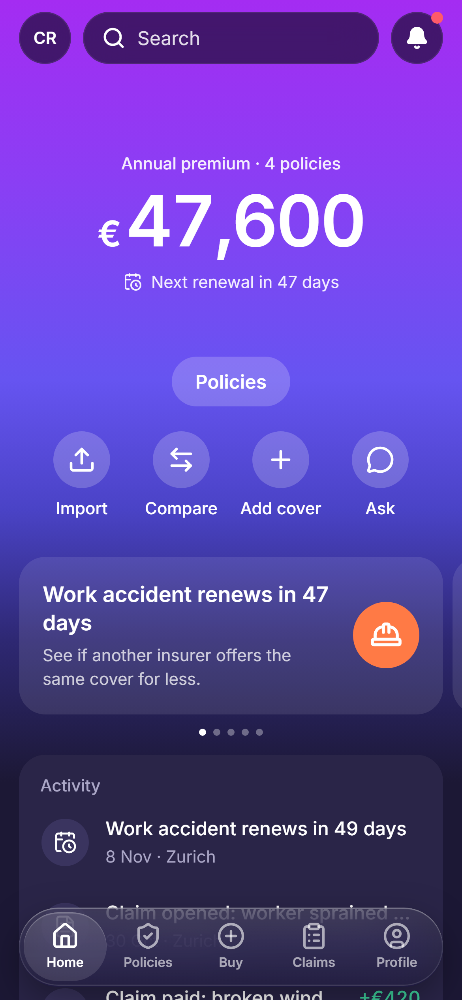
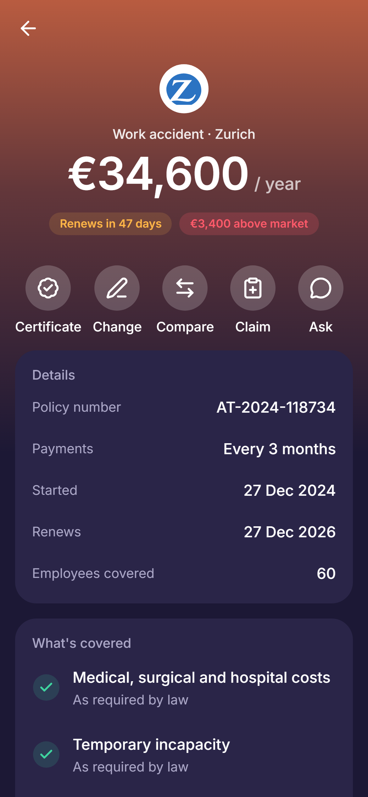
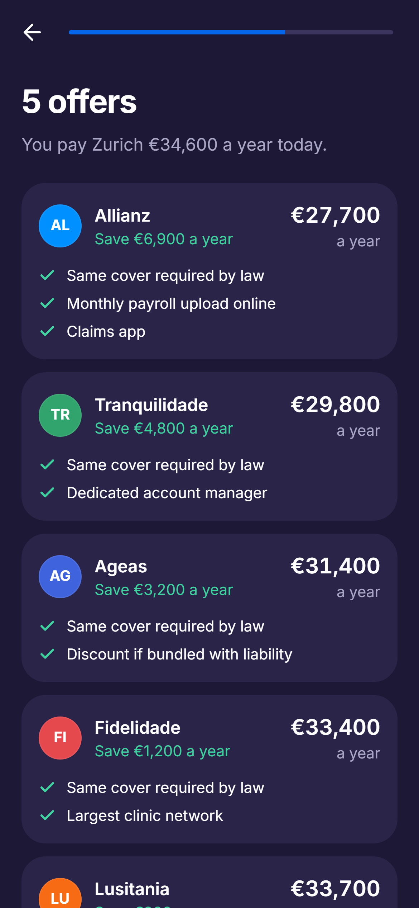
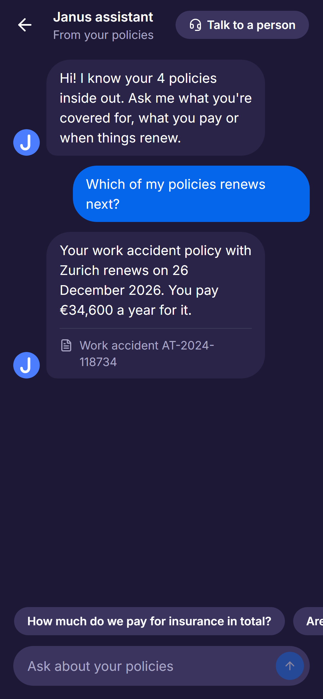

<p align="center"></p>

<h1 align="center">Janus</h1>

<p align="center">
  <b>All your company's insurance, in one app.</b><br>
  See every policy, know what's renewing, switch to a cheaper insurer and file claims, without phoning a broker.
</p>

<p align="center">
  <a href="https://janus.jose-maria-martins.workers.dev"></a>
</p>

<p align="center">
  
  
  
  
</p>

## What you can do

> *"Our work accident policy renews in 47 days. Is anyone cheaper?"*

Janus is a prototype of a Revolut-style app for the insurance of Portuguese companies. In it you can:

- **Start from your NIF.** Janus finds the company's details and the policies it already has.
- **See everything in one place.** What you pay a year, what each policy covers, and what needs you next.
- **Compare and switch at renewal.** Get offers for the same cover and switch in a few taps.
- **Add cover** the company is missing, or import a policy from a PDF.
- **File and follow claims** step by step.
- **Ask** about your policies in plain language, or chat with a person.
- **Run it as a team.** Invite colleagues, see payments, and make insurance certificates.

## Try it

Open **[janus.jose-maria-martins.workers.dev](https://janus.jose-maria-martins.workers.dev)**. Nothing to install and no account needed.

- **Best on a phone.** It works on a laptop too.
- **Nothing is real.** The company, policies and prices are made up. No money moves.
- **Your own copy.** Changes are saved in your browser only, so nobody else sees them.
- **Start over** from **Profile**, **Reset demo**.

## Why it exists

Built for *Product Management in Technology* (2785) at Nova SBE, taught by Sam Rhea.

## Run it locally

```bash
npm install
npm run dev
```

Built with Vite, React, TypeScript, Tailwind and shadcn/ui. There is no backend: all data comes from [`src/data/mock.json`](src/data/mock.json), and dates move with today's date so the demo never goes stale.

Pushing to `main` deploys to Cloudflare Workers.
